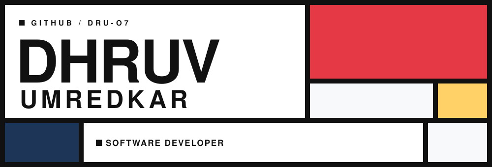
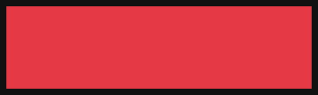
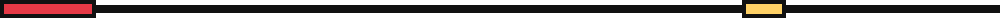
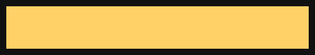
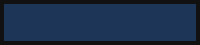
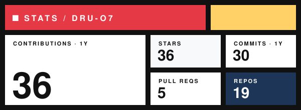
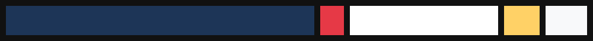

<!-- ═══════════════ COMPOSITION Nº 1 — DHRUV UMREDKAR ═══════════════ -->

<picture><source media="(prefers-color-scheme: dark)" srcset="assets/header-dark.svg" /></picture>

<!-- BAND I · ABOUT (wide white) | CONTACT (narrow, red patch) -->
<table border="0" cellpadding="14" cellspacing="0" width="100%">
<tr>
<td width="66%" valign="top">

### ■ ABOUT

I'm **Dhruv**, a software developer and cyber security enthusiast from **India**. I like building reliable server-side systems and understanding how they break.

▪ **Role** — Software Developer 
▪ **Interest** — Cyber Security 
▪ **Currently building** — [IT Ticketing Application](https://github.com/Dru-O7/ticketing-platform)

</td>
<td width="34%" valign="top">

<picture><source media="(prefers-color-scheme: dark)" srcset="assets/block-red-dark.svg" /></picture>

### □ CONTACT

 

</td>
</tr>
</table>

<picture><source media="(prefers-color-scheme: dark)" srcset="assets/rule-dark.svg" /></picture>

<!-- BAND II · STACK (narrow label column | wide badge field) -->
<table border="0" cellpadding="12" cellspacing="0" width="100%">
<tr>
<td width="24%" valign="top"><b>■ LANGUAGES</b></td>
<td valign="top">
      
      
      
      
</td>
</tr>
<tr>
<td width="24%" valign="top"><b>■ FRAMEWORKS</b></td>
<td valign="top">
      
      
      
</td>
</tr>
<tr>
<td width="24%" valign="top"><b>■ DATA</b></td>
<td valign="top">
      
      
      
</td>
</tr>
<tr>
<td width="24%" valign="top"><b>■ TOOLING</b></td>
<td valign="top">
      
</td>
</tr>
</table>

<picture><source media="(prefers-color-scheme: dark)" srcset="assets/rule-dark.svg" /></picture>

<!-- BAND III · SIGNAL (narrow, yellow patch) | STATS (wide) — split flipped against Band I -->
<table border="0" cellpadding="14" cellspacing="0" width="100%">
<tr>
<td width="30%" valign="top">

<picture><source media="(prefers-color-scheme: dark)" srcset="assets/block-yellow-dark.svg" /></picture>

### □ SIGNAL

 

<picture><source media="(prefers-color-scheme: dark)" srcset="assets/block-blue-dark.svg" /></picture>

</td>
<td width="70%" valign="top">

### ■ STATS

<picture><source media="(prefers-color-scheme: dark)" srcset="assets/stats-dark.svg" /></picture>

</td>
</tr>
</table>

<picture><source media="(prefers-color-scheme: dark)" srcset="assets/footer-dark.svg" /></picture>
